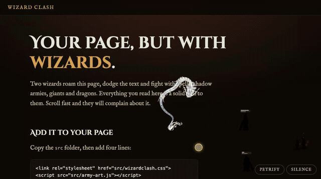

# Wizard Clash



Two wizards roam your page, dodge your text and fight with spells, shadow armies and giants. Every heading and paragraph
is a solid wall to them. Scroll too fast and they complain about it. Drop it into any page: plain JS, no dependencies, no build step.

It was born on [kasanaa.com](https://kasanaa.com). Free and open source (MIT). If it made you smile, a star is very welcome.

## Add it to your page

Copy the `src` folder next to your page, then:

```html
<link rel="stylesheet" href="src/wizardclash.css">
<script src="src/army-art.js"></script>
<script src="src/wizardclash.js" data-header=".site-header"></script>
```

That's it. Try the demo: `python3 -m http.server 8000` and open http://localhost:8000.

## Optional: the cursor dragon

Add one more line after `wizardclash.js` and a dragon circles your cursor. Double-click a spot and it breathes blue fire there
(buoyancy, turbulence, drag, bouncing sparks, smoke, embers, bloom). The blast kills minions and hurts wizards in range.

```html
<script src="src/serpent.js"></script>
```

It loads `serpent-strip.png` from the same folder, and follows the same rules as the show: off under reduced motion, frozen by
*Petrify*, hidden by *Silence*. Dragon art: ["chinese dragon"](https://sketchfab.com/3d-models/chinese-dragon-1d1a07b607b741e08dcb93e594d3e883) by ok100,
[CC BY 4.0](https://creativecommons.org/licenses/by/4.0/); keep that credit if you ship it.

## Options

Put them on the script tag, or start it yourself with `data-manual` and call `WizardClash.start({ ... })`.

| Option (`data-` attribute) | What it does |
|---|---|
| `walls` (`data-walls`) | CSS selector for what the fighters must dodge. Default: headings, paragraphs, lists, images, video, pre, blockquote, table, buttons, inputs and anything with the class `wizard-wall`. |
| `header` (`data-header`) | Selector for a fixed or sticky header they must not cross. |
| `controls` (`data-no-controls` to turn off) | The two corner buttons. Leave them on. |

```js
WizardClash.start({ walls: ".card, h1, p", header: ".site-header" });
WizardClash.freeze();   // statues
WizardClash.resume();
WizardClash.silence();  // switch it all off
```

## Visitors stay in control

- **Petrify** freezes everyone like statues. **Silence** switches the whole show off and remembers it for next time.
- It is decoration only: `aria-hidden`, no pointer events, and it never runs for visitors who prefer reduced motion.
- The buttons wear your page's look automatically: its text colour, background, link colour (as the accent) and font. They re-read it when you switch themes (dark mode, a `class` or `data-theme` change).
- To pin any of it, set `--wc-ink`, `--wc-ink-soft`, `--wc-bg`, `--wc-line`, `--wc-accent` or `--wc-font` on `:root`.

## Make it yours

The wizards, minions and giants are plain vector data. Point your coding agent at [AGENTS.md](AGENTS.md) and ask it to
swap in your own cast: a samurai and a ninja, rival footballers, your own team at work. Use original characters, or keep a fan
project private.

`tools/silhouettes/` is an optional offline helper that turns any drawing into the shadow art the engine uses.

## License

MIT, see `LICENSE`.
